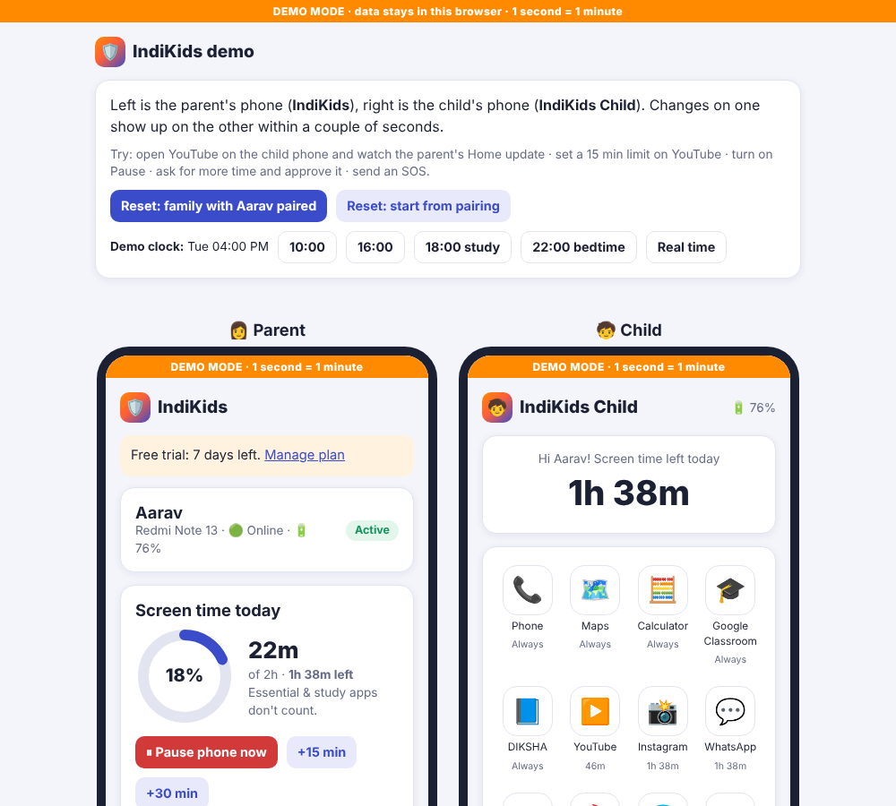
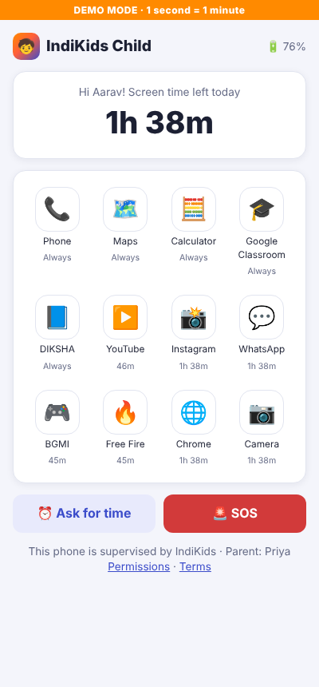
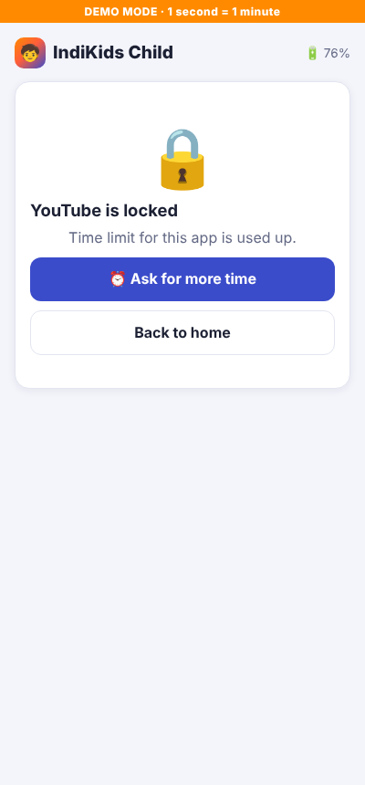
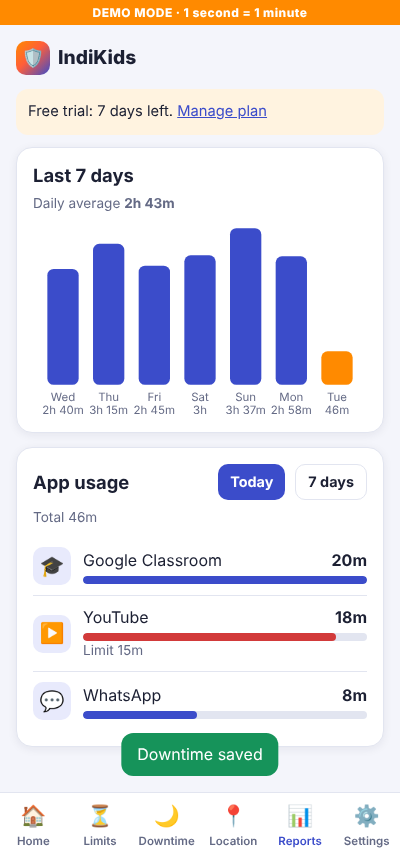
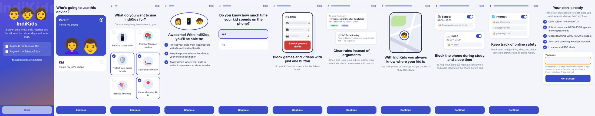

# 🛡️ IndiKids – parental control (Kids360-style)

Two apps that work together:

| App | Who uses it | What it does |
|---|---|---|
| **IndiKids** (`parent.html`) | Parent | Screen time limits, per-app limits and blocking, **one-button "Block games & videos"**, scheduled downtime (**School** locks games & entertainment, **Sleep** locks all apps), pause phone, live location, 7-day usage reports, **Internet safety** (adult/gambling filter, blocked/allowed sites, browser & YouTube history), approve "more time" requests, SOS alerts, subscription, close account |
| **IndiKids Child** (`child.html`) | Child's phone | Pairs with a 6-digit code, asks for permissions, shows apps with time left, locks apps when time is up, filtered browser and YouTube search, "Ask for time", SOS |

**Onboarding** (`index.html`): accept Terms of Use **and** Privacy Policy → *Who's going to use this device?* (Parent / Kid) →
*What do you want to use IndiKids for?* (6 goals) → personalised "you'll be able to" list → six yes/no questions with feature screens in between →
"Your plan is ready" + sign-up. The answers decide which rules are switched on for the first child (e.g. "Yes" to sleep/study time turns on School and Sleep downtime).

The features, pairing steps (3.1–3.5), free trial, cancellation (7.1) and safety reporting (8.2) follow the [Terms of Use](public/terms.html).
A draft [Privacy Policy](public/privacy.html) covers what is collected, 30-day retention and India's DPDP Act 2023 parental consent — have a lawyer review it before publishing.



| Child home | App locked | Parent reports |
|---|---|---|
|  |  |  |



## 1. Try the demo first

No sign-up, nothing leaves the browser.

```bash
cd indikids
node server.js          # needs Node 18+, no npm install
```

Open <http://localhost:8080/demo.html>. The parent phone is on the left and the child phone on the right.
In demo mode **1 second counts as 1 minute** of screen time, so limits are reached quickly.

Things to try:
1. Child: open **YouTube** → Parent Home shows "Now using YouTube" and the minutes go up.
2. Parent → **Limits** → set YouTube to 15m → the child is thrown out to a lock screen.
3. Child: **Ask for more time** → Parent: **Approve** → YouTube unlocks.
4. Parent: **Block games & videos** → games, video and social apps lock; WhatsApp and study apps stay open.
5. Demo clock **10:00 school** (Mon–Fri) → only games and entertainment lock. **22:00 sleep** → everything but essential apps locks.
6. Child: open **Chrome**, visit `online-casino.com` → blocked. Parent → **Internet** tab shows the history, with the blocked visit marked.
7. Child: **SOS** → red alert on the parent Home; check **Location**.
8. **Reset: start from pairing** → walk through pairing a new child with a code.

You can also open `public/demo.html` directly from the folder without the server.

## 2. Use it for real (live mode)

1. Run `node server.js` on a computer or small server that both phones can reach
   (for location to work on phones the site must be **HTTPS**, e.g. behind Caddy/nginx or a tunnel such as Cloudflare Tunnel).
2. Parent phone: open the site → accept Terms and Privacy Policy → **Parent** → answer the setup questions → **Get Started**. Add to home screen.
3. Parent app → **Get pairing code** (valid 30 minutes, single use).
4. Child phone: open `/child.html` → enter the code and name → accept → allow Location, Usage access, Accessibility. Add to home screen as *IndiKids Child*.

Data is saved in `data/indikids.json` (change with `DATA_FILE=...`, port with `PORT=...`). Back it up; it is git-ignored.

## Important limits of this version

This is an installable **web app (PWA)**. A browser cannot see or close other apps on a phone, so in this version
the child opens apps **from the IndiKids Child launcher**, and screen time is counted there. Location and battery are real.
To lock YouTube, games etc. system-wide like Kids360 does, the child app must be a **native Android app** using:

- `UsageStatsManager` (Usage access) – count time per app
- `AccessibilityService` – detect the app in front and show the lock screen over it
- `DevicePolicyManager` / Device Admin – stop the child uninstalling IndiKids Child
- Foreground service + `FusedLocationProviderClient` – background location

The rules engine (`public/core.js`) and the server API are written so a native Android child app can reuse them unchanged:
it only needs to call `POST /api/me/report` with usage and location and apply the returned rules.

Internet safety in this version covers websites and YouTube searches made through IndiKids Child's own browser; the
adult/gambling filter is a small built-in keyword list. A native app would read the real Chrome/YouTube address bar via the
AccessibilityService, or use a DNS-based filter (e.g. Android Private DNS with a family filter) for system-wide blocking.

Not connected yet: Google Play / App Store billing (Premium activates free), push notifications (the parent app polls every few seconds), email.

Before publishing, fill in the company address in `public/terms.html` and `public/privacy.html`
(`[Insert Your Business Address Here]`) and the Grievance Officer name in the Privacy Policy.

## Files

```
server.js            Node server: static files + JSON API (no dependencies)
public/core.js       Rules engine: limits, downtime, what is locked and why
public/store.js      Data store used by both the server and the demo
public/api.js        Chooses live (server) or demo (in-browser) backend
public/index.html    Onboarding: consent, parent/kid, goals, questions, sign-up
public/parent.html   IndiKids parent app
public/child.html    IndiKids Child app
public/demo.html     Both phones side by side
public/terms.html    Terms of Use
public/privacy.html  Privacy Policy (draft)
tests/               Unit tests, API test, browser test of demo + live mode
```

## Tests

```bash
npm test             # rules engine, store and API (node --test)
npm run test:e2e     # drives both apps in Chromium (needs Playwright)
```
